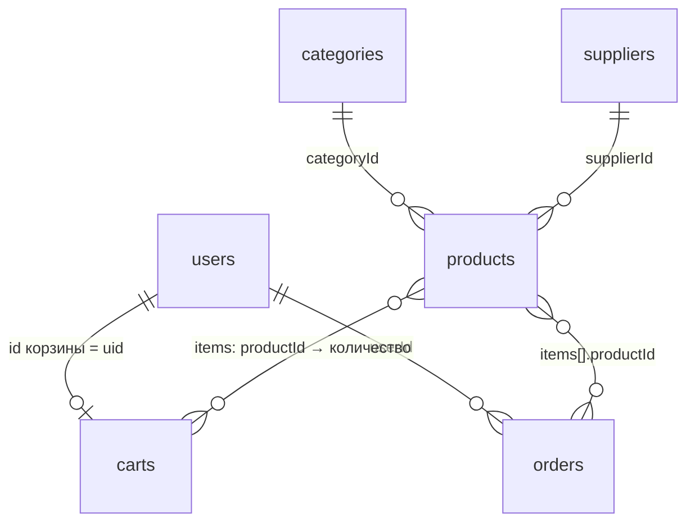

# Структура базы данных

База — **Cloud Firestore** (документная NoSQL-база Firebase). Данные лежат в коллекциях документов;
у каждого документа свой идентификатор, связи между коллекциями — через поля с идентификаторами
(аналог внешних ключей в реляционной базе).



## Коллекции

### `categories` — категории

Идентификатор документа — короткое латинское имя (`soil`, `hand`, …): оно же стоит в адресе
страницы `index.html?category=soil`.

| Поле | Тип | Описание |
|---|---|---|
| `name` | string | Название: «Почвообработка» |
| `icon` | string | Имя иконки из `public/img/icons` без `.svg` |
| `purpose` | string | Назначение: `field` — поле, `garden` — дача и сад, `general` — общие сельхозработы |
| `order` | int | Порядок иконки на главной странице |
| `description` | string | Короткое описание |

### `products` — товары

| Поле | Тип | Описание |
|---|---|---|
| `name` | string | Наименование |
| `categoryId` | string | → `categories` |
| `purpose` | string | Назначение (по умолчанию как у категории; ручная сеялка в «Посевной технике» — `garden`) |
| `type` | string | `heavy` — крупное оборудование, `mini` — мини-инструмент |
| `supplierId` | string | → `suppliers` |
| `manufacturer` | string | Производитель (бренд) |
| `origin` | string | Для фильтра: `china` или `europe` |
| `country` | string | Для показа: «Германия» |
| `price` | int | Цена в тенге, целое число |
| `priceRange` | string | Ценовой диапазон: `upTo20k`, `20kTo100k`, `100kTo500k`, `over500k` |
| `stock` | int | Остаток на складе, шт.; 0 — на сайте показывается «Под заказ» |
| `inStock` | bool | Для фильтра «Только в наличии»: `stock > 0` |
| `sortName` | string | Для сортировки по названию: название строчными буквами, «е» вместо «ё» |
| `searchTokens` | array\<string\> | Для поиска: начала слов названия и производителя от 2 букв (`ло`, `лоп`, …, `лопата`) |
| `description` | string | Описание |
| `specs` | map | Характеристики: `{ "Ширина захвата": "2,5 м", … }` |
| `images` | array\<string\> | Пути к фотографиям в Cloud Storage: `products/<id>/main.jpg` (960×720) |
| `thumbnail` | string | Уменьшенное фото для каталога: `products/<id>/thumb.jpg` (480×360) |
| `imageCredit` | map | Автор фото: `author`, `license`, `source` (ссылка на исходный файл) |
| `createdAt` | timestamp | Дата добавления — для сортировки «сначала новые» |

`manufacturer`, `origin` и `country` повторяют данные поставщика. Это сделано нарочно: Firestore не
умеет объединять коллекции (JOIN) в одном запросе, а фильтр по стране должен работать одним запросом.

`priceRange`, `inStock`, `sortName` и `searchTokens` вычисляются из других полей при сохранении
товара (функция `derivedFields` в `public/js/catalog.js`). Они нужны только для запросов каталога:

- `priceRange` и `inStock` превращают сравнения (`price < 20000`, `stock > 0`) в равенства. Равенства
  Firestore сочетает с любой сортировкой и с другими равенствами, используя небольшие индексы
  (см. «Индексы»), а сравнение по второму полю потребовало бы отдельного индекса на каждое сочетание.
- `sortName` — потому что Firestore сравнивает строки по кодам символов: «Ёмкость» оказалась бы
  перед «Бороной» (код «Ё» меньше, чем у «А»), а название со строчной буквы — после всех заглавных.
- `searchTokens` — потому что в Firestore нет полнотекстового поиска. Есть только `array-contains`:
  «в массиве есть такой элемент». Начала слов превращают поиск по началу слова в такую проверку.

Как работает поиск (`public/js/search.js`): запрос приводится к строчным буквам и «е» вместо «ё»,
делится на слова, у слов длиннее 4 букв отбрасывается окончание («лопаты» → «лопат»,
«бензиновый» → «бензинов»). Самую длинную основу ищет база (`searchTokens array-contains`),
остальные проверяет браузер: в одном запросе Firestore допускает только одно условие
`array-contains`. Это не морфологический анализ: «лопат» найдёт «лопата» и «лопаты», но поиск не
знает синонимов и не исправляет опечатки.

### `suppliers` — поставщики

| Поле | Тип | Описание |
|---|---|---|
| `name` | string | Название компании |
| `brand` | string | Бренд, под которым продаются товары |
| `country` | string | Страна |
| `origin` | string | `china` или `europe` |
| `contacts` | map | `email`, `phone`, `website` |

Список товаров поставщика не хранится в его документе, а получается запросом
`products where supplierId == <id>`: так список не может разойтись с каталогом.

### `users` — пользователи

Идентификатор документа — `uid` из Firebase Authentication. Пароли здесь не хранятся: их хранит и
проверяет Firebase Authentication.

| Поле | Тип | Описание |
|---|---|---|
| `name` | string | Имя |
| `email` | string | Электронная почта (совпадает с адресом входа) |
| `phone` | string | Телефон |
| `addresses` | array\<map\> | Адреса доставки: `label`, `city`, `street` (не больше 5) |
| `role` | string | `customer`, `manager`, `content`, `admin` |
| `createdAt` | timestamp | Дата регистрации |

### `carts` — корзины

Идентификатор документа — `uid` владельца, поэтому у каждого покупателя одна корзина, и она
сохраняется между посещениями сайта.

| Поле | Тип | Описание |
|---|---|---|
| `items` | map | `{ <productId>: <количество> }`, не больше 50 позиций |
| `updatedAt` | timestamp | Время последнего изменения |

Цен в корзине нет: итоговую сумму считает сервер по ценам из каталога в момент оформления.

### `orders` — заказы

Создаются и меняются только функциями Cloud Functions: `placeOrder` (оформление) и `setOrderStatus`
(смена статуса), см. раздел «Cloud Functions» ниже. Тестовая база содержит ещё 8 демонстрационных
заказов всех статусов (`seed/orders.json`; ТЗ, п. 2.5).

| Поле | Тип | Описание |
|---|---|---|
| `number` | string | Номер заказа для покупателя: `AD-000123` |
| `userId` | string | → `users` |
| `items` | array\<map\> | `productId`, `name`, `price` (цена на момент заказа), `qty`; `fromStock` — сколько штук зарезервировано со склада, `backorder` — сколько под заказ |
| `total` | int | Итоговая сумма, ₸ |
| `delivery` | map | `method`: `pickup` / `delivery`, `address` |
| `contact` | map | `name`, `phone` |
| `comment` | string | Комментарий покупателя |
| `status` | string | `new`, `confirmed`, `picking`, `shipped`, `readyForPickup`, `completed`, `cancelled` |
| `statusHistory` | array\<map\> | `status`, `at` (время), `by` (uid того, кто сменил статус: покупателя или сотрудника) |
| `createdAt` | timestamp | Дата оформления |

### `meta` — сводка для каталога

Документ `meta/catalog` хранит список производителей для выпадающего списка в блоке фильтров:
`manufacturers` (array\<string\>, по алфавиту) и `updatedAt`. Firestore не умеет выбирать
различающиеся значения поля (аналог `SELECT DISTINCT`), а читать ради списка все товары дорого.
Документ обновляет Cloud Function `syncCatalogMeta` — триггер на изменение товаров (а при заполнении
тестовыми данными — ещё и скрипт `seed.js`).

### `counters` — служебные счётчики

Документ `counters/orders` хранит последний выданный номер заказа. Его читает и увеличивает
`placeOrder` в той же транзакции, что создаёт заказ, поэтому два одновременных заказа не получат
один номер. Доступен только Cloud Functions.

## Правила доступа

Описаны в [`firestore.rules`](../firestore.rules) и проверяются тестами
[`tests/firestore.rules.test.js`](../tests/firestore.rules.test.js).

| Коллекция | Гость | Покупатель | Менеджер | Контент-менеджер | Администратор |
|---|---|---|---|---|---|
| `categories`, `products`, `meta` | чтение | чтение | чтение | чтение и запись | чтение и запись |
| `suppliers` | — | — | чтение | чтение и запись | чтение и запись |
| `users` | — | свой профиль, без смены роли | свой + чтение всех | свой профиль | все, смена ролей |
| `carts` | — | своя корзина | — | — | — |
| `orders` | — | чтение своих | чтение всех | — | чтение всех |

Запись в `orders` и `counters` закрыта для всех: заказы создают и меняют только Cloud Functions,
которые работают через Admin SDK, а он правила не проверяет. Так покупатель не может подменить
цену или сумму, а смена статуса проходит проверки на сервере.

Таблица проверяется автоматически: матрица в `tests/firestore.rules.test.js` пробует 32 действия от
имени каждой из пяти ролей. Правила для фото (`storage.rules`) проверяет `tests/storage.rules.test.js`.

Кроме прав правила проверяют сами данные:

| Что | Проверка |
|---|---|
| Товар | только известные поля; обязательные на месте; типы и значения верны; цена — целое число до 1 млрд; `priceRange` соответствует цене, `inStock` — остатку; `sortName` — строка той же длины, что и название; `searchTokens` — список не длиннее 400; категория и поставщик существуют; `createdAt` ставит сервер и он не меняется |
| Сводка каталога | только документ `meta/catalog`, только `manufacturers` (список до 200) и `updatedAt` от сервера; удалить нельзя |
| Категория | только известные поля; назначение из списка; `order` — целое число |
| Поставщик | только известные поля; регион `china` или `europe` |
| Профиль | только известные поля; роль из списка; телефон из цифр и знаков `+ - ( )` до 20 символов; до 5 адресов, в адресе только `label`, `city`, `street`; при регистрации роль `customer`, своя почта, дата от сервера; почту и дату регистрации не меняет никто |
| Корзина | только `items` и `updatedAt`; не больше 50 позиций; количество правила проверить не могут (в них нет циклов), его проверяет Cloud Function `placeOrder` (целое от 1 до 99) |

## Cloud Functions

Операции, которые нельзя доверить браузеру (ТЗ, п. 2.2), выполняют функции в
[`functions/index.js`](../functions/index.js). Они работают через Admin SDK, который правила
Firestore не проверяет, поэтому права проверяются в самих функциях — по входу и роли из `users`.
Регион — `europe-central2` (Варшава), ближайший к Казахстану.

| Функция | Кто вызывает | Что делает |
|---|---|---|
| `placeOrder` | покупатель | в одной транзакции читает корзину, цены и остатки, считает сумму, резервирует товар (`stock` уменьшается, `inStock` пересчитывается), выдаёт номер из `counters/orders`, создаёт заказ со статусом «Новый» и очищает корзину |
| `setOrderStatus` | менеджер, администратор; покупатель — только отмена нового заказа | проверяет переход по таблице статусов, дописывает запись в `statusHistory`; при отмене возвращает зарезервированный товар на склад |
| `importCsv` | товары — контент-менеджер и администратор; клиенты — администратор | разбирает CSV из Excel, проверяет каждую строку; товары создаёт или обновляет (по коду или названию), клиентам создаёт вход в Authentication без пароля и профиль покупателя |
| `syncCatalogMeta` | триггер на запись в `products` | пересчитывает `meta/catalog`, если товар добавлен, удалён или у него сменился производитель |

Ход заказа (ТЗ, п. 1.5) — конечный автомат; допустимые переходы заданы одной функцией
`nextStatuses` в `public/js/dictionaries.js`, её используют и Cloud Function, и админ-панель:

```
new → confirmed → picking → shipped (доставка)        → completed
                          ↘ readyForPickup (самовывоз) ↗
new, confirmed, picking → cancelled
```

Защита от подмены и гонок:

- браузер не передаёт ни цен, ни суммы — только данные формы; сумму считает функция по каталогу;
- браузер передаёт сумму, которую видел покупатель (`expectedTotal`); если цена за это время
  изменилась, заказ не создаётся, и покупатель видит новую сумму;
- товар, которого нет на складе, можно заказать «под заказ»: зарезервируется сколько есть, остальное
  попадёт в `backorder`, и менеджер уточнит срок поставки;
- если двое одновременно покупают последний товар, Firestore повторит одну из транзакций уже с
  новым остатком — второй заказ получит этот товар «под заказ», а не уведёт остаток в минус.

Общие для сайта и функций модули (`dictionaries.js`, `search.js`, `catalog.js`) копируются в
`functions/shared/` скриптом `scripts/sync-shared.js`: функции публикуются только из папки
`functions/`. Совпадение копий с оригиналами проверяет `tests/functions-logic.test.js`.

## Индексы

Firestore выполняет запрос только по индексу — отсортированному списку «значения полей → документ».
Индекс по одному полю создаётся сам, а для фильтра по одному полю с сортировкой по другому нужен
составной индекс. Эмулятор индексы не требует, а настоящая база без нужного индекса отвечает
ошибкой `FAILED_PRECONDITION` (сайт тогда показывает «Такое сочетание фильтров пока не
поддерживается»).

Индексы описаны в [`firestore.indexes.json`](../firestore.indexes.json). Для каталога файл строит
скрипт `node scripts/indexes.js` по списку фильтров и сортировок из `public/js/catalog.js`:

- на каждое поле фильтра (8 полей, включая `searchTokens`) и каждую сортировку (4) — индекс
  «поле + сортировка», всего 32;
- для своего диапазона цены при сортировке не по цене — «сортировка + цена» и
  «поле + сортировка + цена», ещё 18.

Индекс на каждое сочетание фильтров завести нельзя: сочетаний тысячи, а лимит — 200 составных
индексов на базу. Запрос с несколькими равенствами Firestore выполняет, объединяя индексы
«поле + сортировка» (index merging, алгоритм zig-zag merge join): идёт по нескольким
отсортированным индексам одновременно и берёт документы, которые есть во всех.

Достаточно ли этих 50 индексов для всех сочетаний на настоящей базе, можно проверить только после
создания проекта Firebase (6-я неделя): эмулятор индексы не проверяет. Тест
`tests/indexes.test.js` проверяет файл: он совпадает с выводом скрипта, и для каждого вида запроса
каталога в нём есть индексы по правилу выше.
