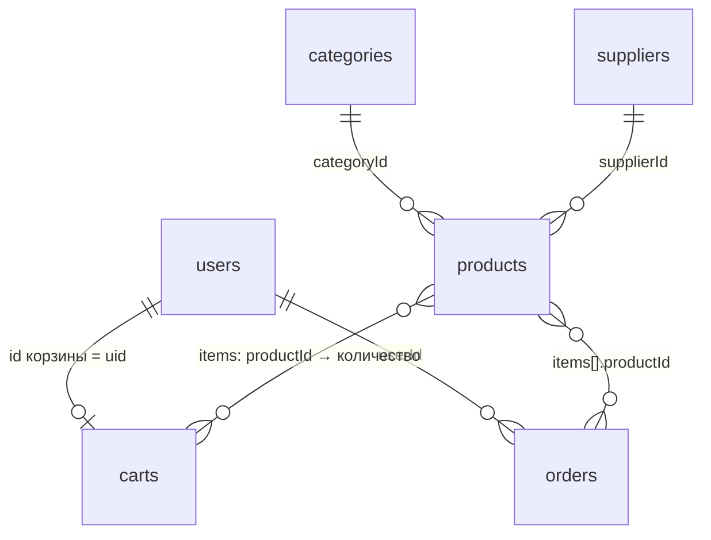

# Структура базы данных

База — **Cloud Firestore** (документная NoSQL-база Firebase). Данные лежат в коллекциях документов;
у каждого документа свой идентификатор, связи между коллекциями — через поля с идентификаторами
(аналог внешних ключей в реляционной базе).

## Коллекции

### `categories` — категории

Идентификатор документа — короткое латинское имя (`soil`, `hand`, …): оно же стоит в адресе
страницы `index.html?category=soil`.

| Поле | Тип | Описание |
|---|---|---|
| `name` | string | Название: «Почвообработка» |
| `icon` | string | Имя иконки из `public/img/icons` без `.svg` |
| `purpose` | string | Назначение: `field` — поле, `garden` — дача и сад, `general` — общие сельхозработы |
| `order` | int | Порядок иконки на главной странице |
| `description` | string | Короткое описание |

### `products` — товары

| Поле | Тип | Описание |
|---|---|---|
| `name` | string | Наименование |
| `categoryId` | string | → `categories` |
| `purpose` | string | Назначение (по умолчанию как у категории; ручная сеялка в «Посевной технике» — `garden`) |
| `type` | string | `heavy` — крупное оборудование, `mini` — мини-инструмент |
| `supplierId` | string | → `suppliers` |
| `manufacturer` | string | Производитель (бренд) |
| `origin` | string | Для фильтра: `china` или `europe` |
| `country` | string | Для показа: «Германия» |
| `price` | int | Цена в тенге, целое число |
| `priceRange` | string | Ценовой диапазон: `upTo20k`, `20kTo100k`, `100kTo500k`, `over500k` |
| `stock` | int | Остаток на складе, шт. |
| `description` | string | Описание |
| `specs` | map | Характеристики: `{ "Ширина захвата": "2,5 м", … }` |
| `images` | array\<string\> | Пути к фотографиям в Cloud Storage: `products/<id>/main.jpg` (960×720) |
| `thumbnail` | string | Уменьшенное фото для каталога: `products/<id>/thumb.jpg` (480×360) |
| `imageCredit` | map | Автор фото: `author`, `license`, `source` (ссылка на исходный файл) |
| `createdAt` | timestamp | Дата добавления — для сортировки «сначала новые» |

`manufacturer`, `origin` и `country` повторяют данные поставщика. Это сделано нарочно: Firestore не
умеет объединять коллекции (JOIN) в одном запросе, а фильтр по стране должен работать одним запросом.

`priceRange` вычисляется из `price` при сохранении товара (функция `priceRangeOf` в
`public/js/dictionaries.js`). Отдельное поле позволяет фильтровать по диапазону простым
сравнением на равенство и сочетать этот фильтр с сортировкой по цене или дате.

### `suppliers` — поставщики

| Поле | Тип | Описание |
|---|---|---|
| `name` | string | Название компании |
| `brand` | string | Бренд, под которым продаются товары |
| `country` | string | Страна |
| `origin` | string | `china` или `europe` |
| `contacts` | map | `email`, `phone`, `website` |

Список товаров поставщика не хранится в его документе, а получается запросом
`products where supplierId == <id>`: так список не может разойтись с каталогом.

### `users` — пользователи

Идентификатор документа — `uid` из Firebase Authentication. Пароли здесь не хранятся: их хранит и
проверяет Firebase Authentication.

| Поле | Тип | Описание |
|---|---|---|
| `name` | string | Имя |
| `email` | string | Электронная почта (совпадает с адресом входа) |
| `phone` | string | Телефон |
| `addresses` | array\<map\> | Адреса доставки: `label`, `city`, `street` (не больше 5) |
| `role` | string | `customer`, `manager`, `content`, `admin` |
| `createdAt` | timestamp | Дата регистрации |

### `carts` — корзины

Идентификатор документа — `uid` владельца, поэтому у каждого покупателя одна корзина, и она
сохраняется между посещениями сайта.

| Поле | Тип | Описание |
|---|---|---|
| `items` | map | `{ <productId>: <количество> }`, не больше 50 позиций |
| `updatedAt` | timestamp | Время последнего изменения |

Цен в корзине нет: итоговую сумму считает сервер по ценам из каталога в момент оформления.

### `orders` — заказы

Создаются и меняются только функциями Cloud Functions (5-я неделя).

| Поле | Тип | Описание |
|---|---|---|
| `number` | string | Номер заказа для покупателя: `AD-000123` |
| `userId` | string | → `users` |
| `items` | array\<map\> | `productId`, `name`, `price` (цена на момент заказа), `qty` |
| `total` | int | Итоговая сумма, ₸ |
| `delivery` | map | `method`: `pickup` / `delivery`, `address` |
| `contact` | map | `name`, `phone` |
| `comment` | string | Комментарий покупателя |
| `status` | string | `new`, `confirmed`, `picking`, `shipped`, `readyForPickup`, `completed`, `cancelled` |
| `statusHistory` | array\<map\> | `status`, `at` (время), `by` (uid сотрудника) |
| `createdAt` | timestamp | Дата оформления |

### `counters` — служебные счётчики

Документ `counters/orders` хранит последний выданный номер заказа. Доступен только Cloud Functions.

## Правила доступа

Описаны в [`firestore.rules`](../firestore.rules) и проверяются тестами
[`tests/firestore.rules.test.js`](../tests/firestore.rules.test.js).

| Коллекция | Гость | Покупатель | Менеджер | Контент-менеджер | Администратор |
|---|---|---|---|---|---|
| `categories`, `products` | чтение | чтение | чтение | чтение и запись | чтение и запись |
| `suppliers` | — | — | чтение | чтение и запись | чтение и запись |
| `users` | — | свой профиль, без смены роли | свой + чтение всех | свой профиль | все, смена ролей |
| `carts` | — | своя корзина | — | — | — |
| `orders` | — | чтение своих | чтение всех | — | чтение всех |

Запись в `orders` и `counters` закрыта для всех: заказы создают и меняют только Cloud Functions,
которые работают через Admin SDK, а он правила не проверяет. Так покупатель не может подменить
цену или сумму, а смена статуса проходит проверки на сервере.

## Индексы

Firestore требует составной индекс для запросов, где фильтр по одному полю сочетается с сортировкой
по другому. Индексы описаны в [`firestore.indexes.json`](../firestore.indexes.json); сейчас там индекс
для «товары категории, сначала новые». Индексы для фильтров и сортировок добавятся на 4-й неделе.
