# Макеты страниц

Вместо макетов в Figma — скриншоты свёрстанных страниц с тестовыми данными из базы. Сделаны в
браузере Chrome: компьютер — окно 1366×900, телефон — 390×844 (iPhone 12–15).

На скриншотах кнопки показаны в обычном виде. Вход, регистрация и личный кабинет уже работают, а
кнопки корзины и админ-панели ещё неактивны: их логика — 5-я неделя по ТЗ. Фото товаров взяты с
Wikimedia Commons, авторы перечислены в [image-credits.md](image-credits.md).

## Главная страница

Иконки категорий вверху страницы, под ними раскрывающийся блок фильтров и сортировки, ниже —
карточки товаров из базы.

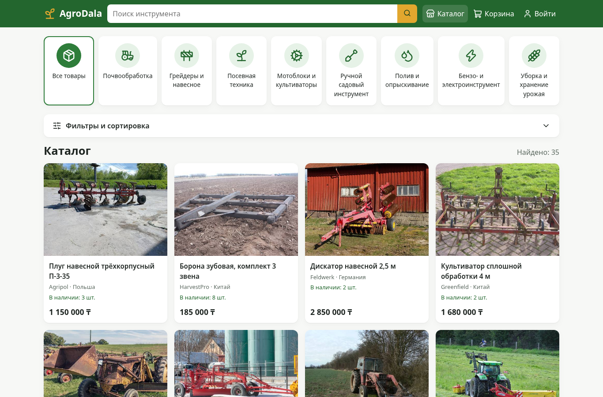

Блок фильтров раскрыт: назначение, тип, страна, ценовой диапазон или своя цена «от — до»,
производитель, наличие, сортировка.

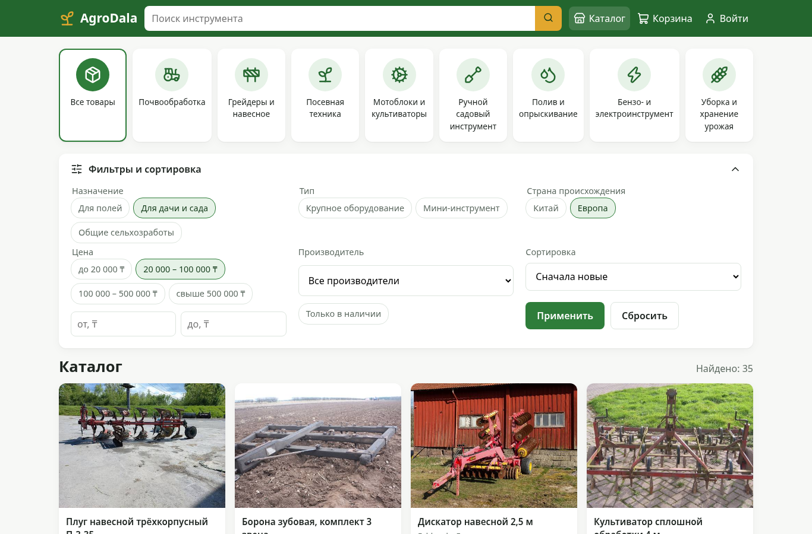

Категория «Полив и опрыскивание» — открывается одним нажатием на иконку.

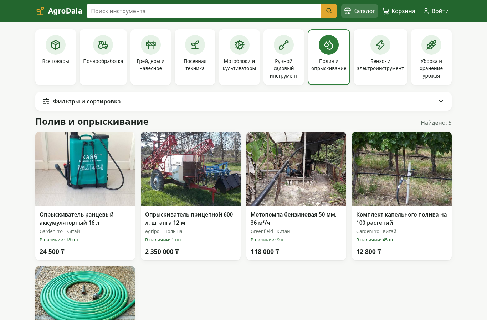

На телефоне иконки категорий прокручиваются по горизонтали, товары идут в две колонки.

| Главная | Фильтры |
|---|---|
| 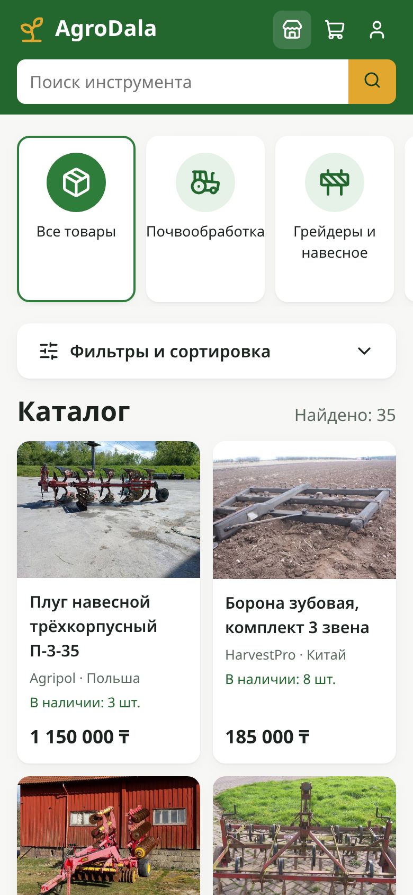 | 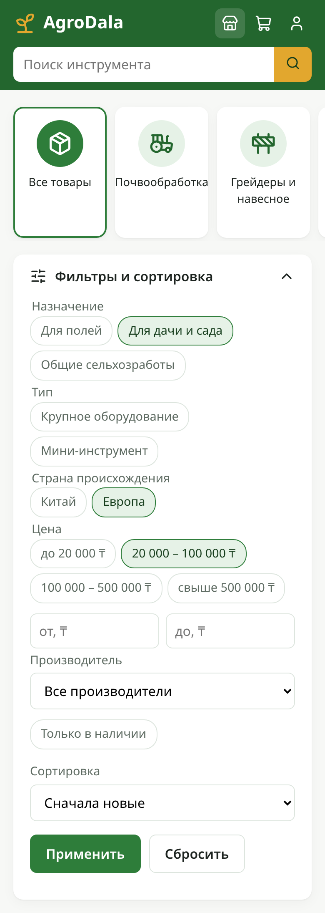 |

## Карточка товара

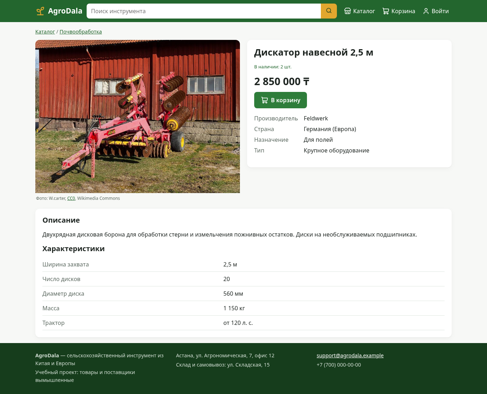

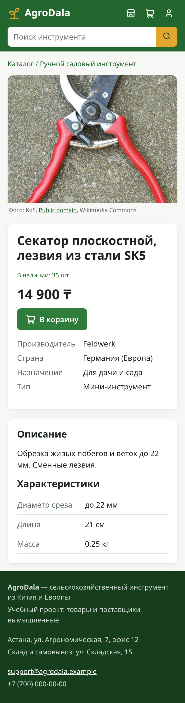

## Корзина и оформление заказа

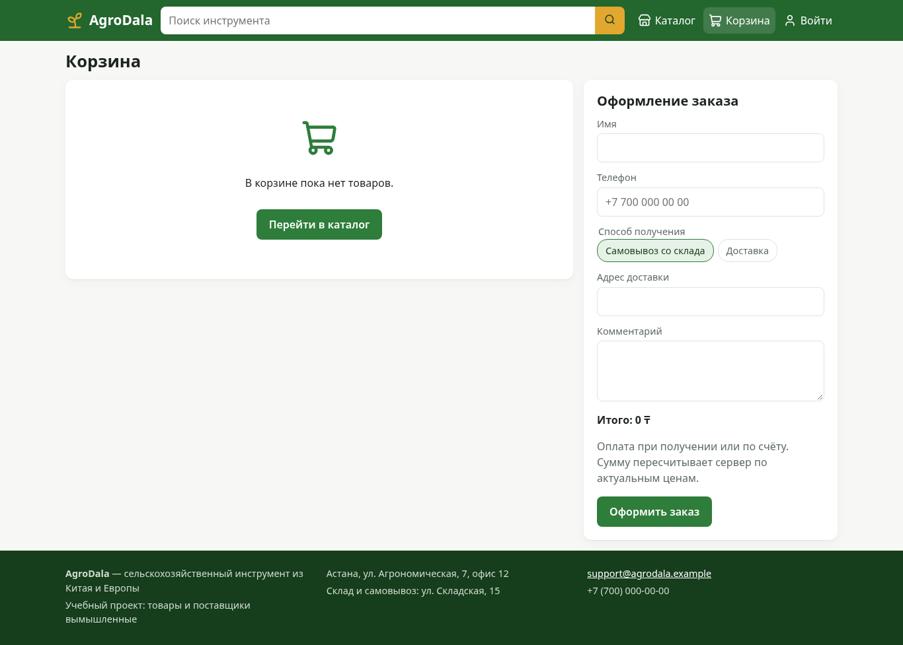

## Вход и регистрация

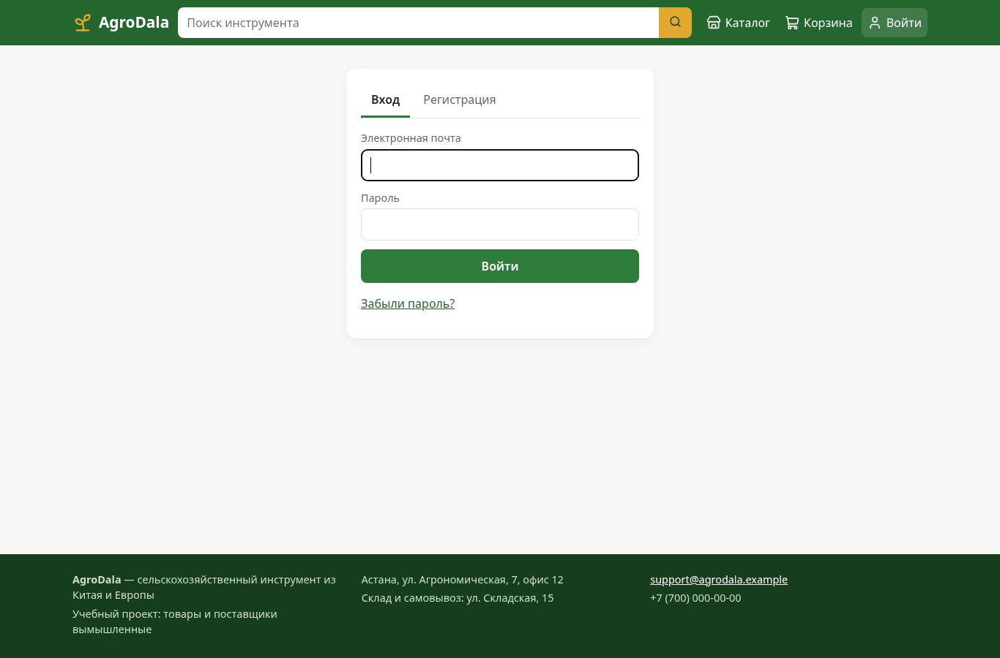

## Личный кабинет

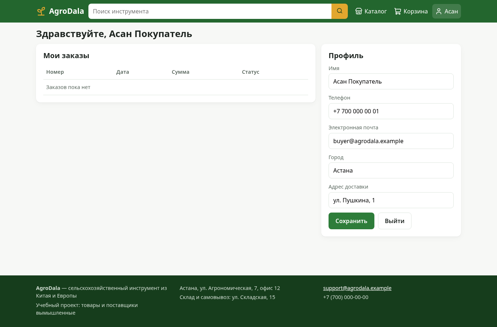

## Административная панель

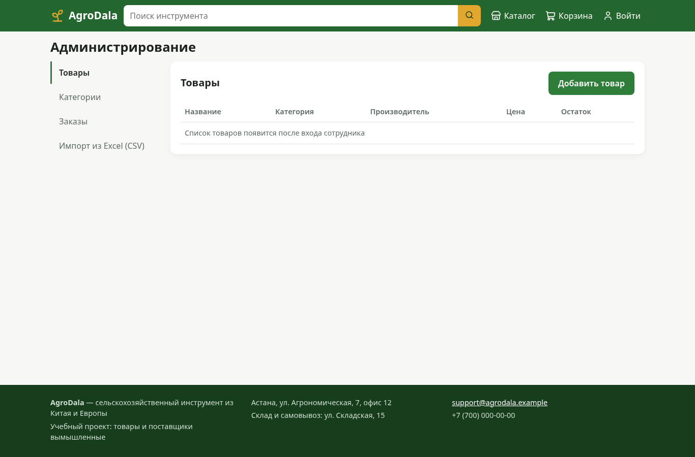

## База данных

Тестовые данные в Cloud Firestore (панель эмулятора Firebase): коллекции слева, документы товара
`diskator-2-5` и его поля справа. Структура описана в [database.md](database.md).

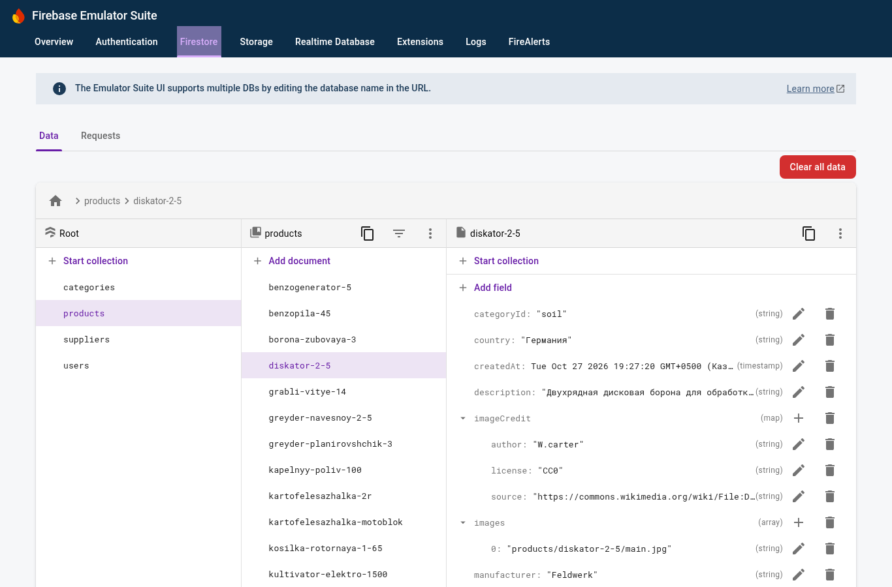
